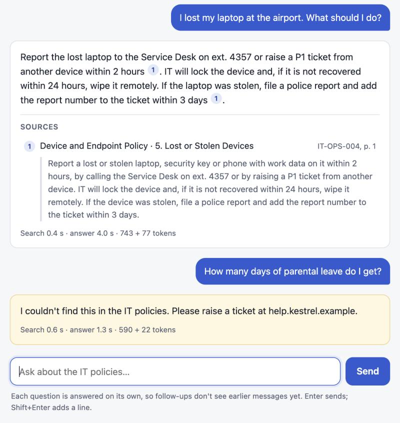
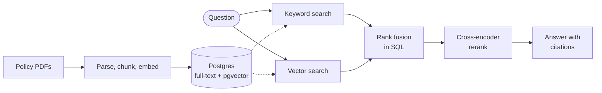

<div align="center">

# Agentic Support Assistant

**An IT help desk assistant that answers from company policy PDFs, cites its sources, and says so when it doesn't know.**

[](https://github.com/PriyamKeshri/Support-Assistant/actions/workflows/docker-image.yml)


<table>
  <tr>
    <td align="center" width="25%"><h3>0.89</h3>right section ranked first</td>
    <td align="center" width="25%"><h3>0.98</h3>right section in the top 5</td>
    <td align="center" width="25%"><h3>0.92</h3>answers grounded in the policies <sub>(LLM-judged)</sub></td>
    <td align="center" width="25%"><h3>6 / 6</h3>off-topic questions declined</td>
  </tr>
</table>



<sub>Kestrel Analytics and its nine IT policies are fictional, written for this project.</sub>

</div>

## How it works



- **Parsing** strips page headers and footers, splits each PDF at its numbered sections, and embeds every chunk with its heading.
- **Hybrid search** runs full-text and vector search in one SQL query and merges the two rankings with reciprocal rank fusion.
- **Reranking** re-scores the top 30 results with a cross-encoder, which reads the question and passage together.
- **Answers** cite `[n]` for every claim, or say the policies don't cover the question. The chat page streams them and links each citation to its excerpt.

## Results

78 labelled questions over 9 policies (59 chunks), on an Apple M4 laptop · [per-question detail](evals/results/retrieval.json)

| Search mode | Hit@1 | Recall@5 | MRR@10 | Latency (p50) |
|:--|:-:|:-:|:-:|--:|
| Keyword | 0.56 | 0.88 | 0.71 | 0.4 ms |
| Semantic | 0.80 | 0.96 | 0.88 | 16 ms |
| Hybrid (RRF) | 0.72 | 0.94 | 0.83 | 18 ms |
| **Hybrid + rerank** | **0.89** | **0.98** | **0.93** | **95 ms** |

<sub>Hit@1: the right section is ranked first · Recall@5: share of the needed sections in the top 5 · MRR: how high the first right section ranks, on average</sub>

- **Reranking pays off:** 9 points more Hit@1 than semantic search, for about 80 ms.
- **Plain hybrid lost to semantic:** common words like "data" and "laptop" pull keyword matches from the wrong policy. Reranking recovers most of them.
- **Weak spot:** questions that need two sections (Recall@5 of 0.75 with reranking, from only 4 questions).

<details>
<summary><b>Answer quality</b> · llama3.1:8b on all 84 questions</summary>

| Metric | Result |
|:--|:--|
| Correct, per the LLM judge | 0.82 (64 of 78) |
| Grounded in the excerpts | 0.92 (72 of 78) |
| Answerable questions refused | 0 of 78 |
| Off-topic questions declined | 6 of 6 |
| Latency, p50 / p95 | 7.9 s / 13.0 s |
| Tokens per question | 659 in, 42 out |

The judge is the same 8B model, and it's unreliable: a manual review of the 14 answers it flagged found 7 judge errors, 5 real mistakes and 2 borderline cases, so true correctness is nearer 0.9. Four of the real mistakes are reasoning slips with the right section retrieved; the fifth is a two-section retrieval miss. [All answers and verdicts](evals/results/answers_llama3.1_8b.json)

</details>

<details>
<summary><b>Recall@5 by question type</b></summary>

| Mode | Exact term (10) | Lookup (23) | Two sections (4) | Paraphrase (41) |
|:--|:-:|:-:|:-:|:-:|
| Keyword | 1.00 | 1.00 | 0.38 | 0.83 |
| Semantic | 1.00 | 1.00 | 0.62 | 0.96 |
| Hybrid (RRF) | 1.00 | 1.00 | 0.38 | 0.94 |
| Hybrid + rerank | 1.00 | 1.00 | 0.75 | 0.99 |

With only 59 chunks, embeddings find exact terms like `VPN-809` too. Keyword search should matter more as the corpus grows.

</details>

<details>
<summary><b>How it's measured</b></summary>

[`evals/questions.jsonl`](evals/questions.jsonl) has 84 questions: 78 labelled with the policy sections that answer them and a reference answer, plus 6 the policies can't answer. Labels are per section, so they survive changes to chunking.

- `make eval`: Hit@k, Recall@k, MRR, nDCG and latency for each search mode. No API key needed.
- `make eval-answers`: correctness and groundedness graded by an LLM judge, plus refusals, latency, tokens and cost. An interrupted run resumes; set `JUDGE_MODEL` for a stronger judge.

</details>

## Tech stack

| Layer | Choice | Why |
|:--|:--|:--|
| API | FastAPI, Pydantic | Typed validation, automatic API docs, streaming responses |
| Storage and search | PostgreSQL 17, pgvector (HNSW), full-text search (GIN) | Both indexes in one table, fused in one query |
| Embeddings | `bge-small-en-v1.5`, run locally | Strong for its size, and free to run, so evals run anytime |
| Reranker | `ms-marco-MiniLM-L-6-v2` cross-encoder | 9 points more Hit@1 for about 80 ms |
| LLM | Any OpenAI-compatible API; `llama3.1:8b` on Ollama | Models swap by config; local development is free and private |
| PDF parsing | pypdf | Pure Python, permissive licence |
| Data access | psycopg 3, hand-written SQL | The fusion and full-text queries stay visible |
| Chat page | One HTML file, plain JavaScript | No build step; streams over server-sent events |
| Quality | Own eval harness, pytest with a fake LLM | Every metric is readable code; tests need no model server |
| Delivery | Docker Compose, GitHub Actions, GitHub Packages | Same environment everywhere; a new image on every push |

<details>
<summary><b>Design trade-offs</b></summary>

- **pgvector, not a vector database such as Chroma or Pinecone:** text search, vectors and, from phase 2, tickets share one system, and fusion is one query. A dedicated vector database pays off at hundreds of millions of vectors.
- **Rank fusion, not score blending:** full-text and cosine scores aren't comparable, and RRF needs only ranks. The cost shows in the results: with equal weights, weak keyword matches get through.
- **Local models, not a hosted API:** free, private and repeatable, but slower (about 8 s per answer) and prone to reasoning slips. Azure OpenAI is planned for phase 4.
- **No LangChain yet:** four plain steps keep every query and prompt testable. LangGraph arrives with the agent in phase 2.

</details>

## Quick start

Needs Docker and Python 3.11+.

```bash
make setup    # virtualenv and dependencies
make db       # Postgres 17 + pgvector in Docker, port 5433
make ingest   # parse, chunk and embed the policy PDFs
make api      # chat at http://localhost:8000, API docs at /docs
```

For answers as well as search, copy `.env.example` to `.env` and point it at a model, for example [Ollama](https://ollama.com): `LLM_BASE_URL=http://localhost:11434/v1` and `LLM_MODEL=llama3.1:8b`. Then try `make test`, `make eval` or `make eval-answers`.

<details>
<summary><b>Docker, prebuilt image and API</b></summary>

```bash
docker compose up -d --build                               # Postgres and the API
docker compose exec api python -m app.ingest
docker pull ghcr.io/priyamkeshri/support-assistant:latest  # prebuilt, linux/amd64
```

Inside the container, `localhost` is the container itself. For Ollama on your machine, set `DOCKER_LLM_BASE_URL=http://host.docker.internal:11434/v1`.

| Endpoint | Returns |
|:--|:--|
| `GET /` | The chat page |
| `POST /search` | Ranked sections; `mode` is `keyword`, `semantic`, `hybrid` or `rerank` |
| `POST /ask` | The answer, numbered citations, timing, tokens and cost |
| `POST /ask/stream` | The same as server-sent events: `sources`, then `token`s, then `done` (or `error`) |
| `GET /health` | Indexed documents and chunks, and the model in use |

```bash
curl -s localhost:8000/ask -H 'content-type: application/json' \
  -d '{"question": "I lost my laptop at the airport. What should I do?"}'
```

</details>

<details>
<summary><b>Project layout</b></summary>

```
app/       API, PDF parsing, chunking, search, answers; the chat page in static/
evals/     labelled questions, metrics, eval runners and saved results
data/      policy sources in Markdown, and the PDFs that get ingested
tests/     unit and integration tests
scripts/   builds the policy PDFs
```

</details>

## Roadmap

| Phase | Scope | Status |
|:--|:--|:--|
| 1. Retrieval core | Hybrid search, reranking, cited streaming answers, evals | ✅ Done |
| 2. Agent | LangGraph agent with ticket tools over MCP, human approval before changes, Langfuse tracing | Next |
| 3. Harder inputs | OCR for scanned PDFs, personal-data masking, prompt-injection tests | Planned |
| 4. Deployment | Azure OpenAI with an open-source fallback, evals in CI, Kubernetes, Azure Container Apps | Planned |
| 5. Triage model | PyTorch ticket classifier tracked in MLflow, compared with the LLM | Planned |
