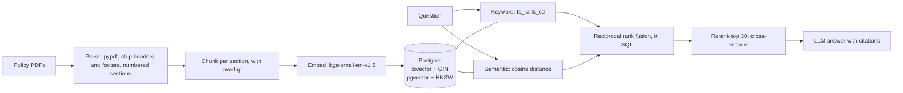

# Agentic Support Assistant

An IT help desk assistant for a company's policy documents. Phase 1 is the retrieval core: it reads policy PDFs, indexes them in **PostgreSQL + pgvector**, finds the right passage with **hybrid search (keyword + semantic) and cross-encoder reranking**, answers with citations in a streaming chat page, and measures all of it against a labelled question set.

Later phases add the agent itself: tools for looking up and changing tickets, served over MCP, with human approval before risky actions (see [Roadmap](#roadmap)).

> The company, Kestrel Analytics, and its nine IT policies are fictional, written for this project.


## Tech stack

| Layer | Choice | Why |
|---|---|---|
| Language | Python 3.11+ | The embedding, reranking and LLM libraries are Python-first, so the API, ingestion and evals share one codebase. |
| API | FastAPI on Uvicorn, Pydantic | Requests are validated from type hints, the interactive docs at `/docs` come for free, and streaming responses power the chat page. |
| Database | PostgreSQL 17 | Holds both search indexes in one table, so keyword and vector results are fused in a single SQL query. Phase 2's tickets will live here too. |
| Vector search | pgvector, HNSW index | Nearest-neighbour search inside Postgres, with no separate vector database to run. HNSW keeps queries fast as the corpus grows. |
| Keyword search | Postgres full-text search (`tsvector`, GIN index, `ts_rank_cd`) | Built into Postgres, and catches exact terms such as error codes, which embeddings can miss. |
| Embeddings | `BAAI/bge-small-en-v1.5`, run locally | Good retrieval quality for a small model, and fast on a laptop. No per-query cost, so the evals can run as often as needed without an API key. |
| Reranker | `cross-encoder/ms-marco-MiniLM-L-6-v2` | Reads the question and passage together, which judges relevance more precisely than comparing embeddings. Small enough to rerank 30 candidates in about 80 ms, and it lifted Hit@1 from 0.80 to 0.89. |
| LLM | Any OpenAI-compatible endpoint; `llama3.1:8b` via Ollama for development | One client works with OpenAI, Azure OpenAI, Groq or a local model, so changing models is a config change. A local model keeps development free and the documents private. |
| PDF parsing | pypdf | Pure Python with a permissive licence (PyMuPDF is AGPL), and enough for text-based PDFs. Scanned PDFs need OCR, planned for phase 3. |
| Database access | psycopg 3, psycopg-pool, hand-written SQL | The search queries are the interesting part (reciprocal rank fusion, OR-style full-text queries), so they stay visible as SQL rather than hidden behind an ORM. |
| Chat page | One HTML file, plain JavaScript | No framework or build step for a single page. Answers stream in as server-sent events. |
| Evaluation | Own harness: Hit@k, Recall@k, MRR, nDCG, LLM judge | Each metric is a few lines of code, so it's clear exactly what every number means. Labels are per section, so they survive changes to chunking. |
| Tests | pytest, with a fake LLM | Unit tests need nothing running, integration tests use the real Postgres, and a fake model makes the streaming and citation tests repeatable. |
| Config | pydantic-settings | Typed settings from environment variables or `.env`; switching model or database needs no code changes. |
| Delivery | Docker, Docker Compose, GitHub Actions, GitHub Packages | The same environment everywhere, one command to start Postgres, and every push to `main` publishes the API image. |

Choices worth explaining:

- **Postgres + pgvector instead of a vector database such as Chroma or Pinecone.** Keyword search, vectors and, from phase 2, tickets all live in one system with one backup and real transactions, and hybrid fusion is a single query. A dedicated vector database earns its place at hundreds of millions of vectors; this corpus is nowhere near that.
- **Reciprocal rank fusion instead of blending scores.** Full-text and cosine scores are on different scales, and RRF needs only ranks. The trade-off shows in the results: with equal weights, a weak keyword match can pull a wrong section up, and the reranker has to fix it.
- **Local models instead of a hosted API.** Free, private and repeatable for development and evals. The cost is speed and reasoning: answers take about 8 seconds on a laptop and an 8B model makes reasoning slips. Moving to Azure OpenAI should only need config changes; it's planned for phase 4.
- **No LangChain in phase 1.** The pipeline is four steps (parse, retrieve, rerank, answer), and writing them directly keeps every query and prompt visible and testable. LangGraph comes in phase 2, where a stateful agent with tools and approval steps actually needs it.

## Results

Retrieval over 78 labelled questions (59 chunks from 9 policies), on an Apple M4 laptop. From `python -m evals.retrieval`; per-question detail in [`evals/results/retrieval.json`](evals/results/retrieval.json).

| Mode | Hit@1 | Recall@5 | MRR@10 | nDCG@10 | p50 latency | p95 latency |
|---|---|---|---|---|---|---|
| keyword | 0.56 | 0.88 | 0.71 | 0.77 | 0.4 ms | 0.8 ms |
| semantic | 0.80 | 0.96 | 0.88 | 0.90 | 16.3 ms | 18.6 ms |
| hybrid (RRF) | 0.72 | 0.94 | 0.83 | 0.86 | 18.2 ms | 21.2 ms |
| **hybrid + rerank** | **0.89** | **0.98** | **0.93** | **0.94** | 94.9 ms | 112.8 ms |

Recall@5 by question type:

| Mode | exact term (10) | lookup (23) | needs 2 sections (4) | paraphrase (41) |
|---|---|---|---|---|
| keyword | 1.00 | 1.00 | 0.38 | 0.83 |
| semantic | 1.00 | 1.00 | 0.62 | 0.96 |
| hybrid (RRF) | 1.00 | 1.00 | 0.38 | 0.94 |
| hybrid + rerank | 1.00 | 1.00 | 0.75 | 0.99 |

What the numbers say:

- **Reranking is worth its cost here.** It puts the right section first for 89% of questions, against 80% for semantic search alone, for about 80 ms more per query.
- **Equal-weight hybrid search did worse than semantic search alone.** Keyword search ranks chunks by shared words, and words like "data", "laptop" and "call" appear across many policies. "What laptop do data scientists get?" sends keyword search to the Data Classification policy, and fusion lets that pull a wrong section to the top. The reranker recovers most of these cases. Weighting the semantic list higher is the obvious next experiment; it needs a separate tuning split so the weights aren't fitted to this test set.
- **Exact terms didn't separate the retrievers.** With only 59 chunks, the embedding model finds error codes like `VPN-809` too. Keyword search should matter more as the corpus grows and similar documents multiply.
- **Questions that need two sections are the weak spot** (only 4 questions, so a small sample). Even with reranking, a quarter of the sections they need are missing from the top 5.

### Answer quality

All 84 questions, answered from the top 5 reranked chunks by `llama3.1:8b` (4-bit, via Ollama on the same laptop) and graded by the same model. From `python -m evals.answers`; every answer and verdict is in [`evals/results/answers_llama3.1_8b.json`](evals/results/answers_llama3.1_8b.json).

| Metric | Result |
|---|---|
| Correct, as graded by the judge | 0.82 (64 of 78 answerable) |
| Grounded: every claim supported by the excerpts | 0.92 (72 of 78 answers) |
| Hallucination rate | 0.08 |
| Answerable questions refused | 0 of 78 |
| Unanswerable questions declined | 6 of 6 |
| End-to-end latency, p50 / p95 | 7.9 s / 13.0 s (generation is 7.6 s of the p50) |
| Tokens per question | 659 in, 42 out ($0, local model) |

**The judge is the weakest part.** I read the 14 answers it marked wrong or ungrounded: 5 are real mistakes, 7 are judge errors (correct answers marked wrong, or "unsupported" claims that the policy does contain) and 2 are borderline. So true correctness is closer to 0.9, and the judge's scores are a floor. Four of the five real mistakes are reasoning slips with the right section retrieved: for example, the model rated a whole team being blocked as P3 instead of P2, and inferred that accounts are ready "2 business days" before a start date. The fifth is the two-section weak spot from the retrieval results: asked about customer phone numbers on a laptop, it got the storage rules but not the section that says customer personal data is Restricted, so it guessed Confidential. Next steps: a stronger judge than the model being graded, and checking the judge's agreement against hand labels before trusting its numbers.

## How it works



**Ingestion** (`app/ingest.py`). Each PDF is parsed with pypdf. Running headers and footers are removed (a line that ends in a page number, or appears on every page), bullet glyphs that come out of PDFs as odd characters are normalised, and the text is split into numbered sections. A heading only counts if it is the next number in sequence, so a numbered list inside a section isn't mistaken for a new section. Sections become chunks of at most 1,200 characters, split on sentence boundaries with a 200-character overlap. Each chunk is embedded together with its heading ("Password Policy > 4. Account Lockout"), so it keeps its context. Re-running ingestion skips files whose SHA-256 hasn't changed.

**Storage** (`app/schema.sql`). One `chunks` table holds both indexes: a generated `tsvector` column (heading weighted above body text) with a GIN index for keyword search, and a `vector(384)` column with an HNSW index for semantic search.

**Retrieval** (`app/search.py`). Four modes over the same index, so they can be compared like for like:

| Mode | How |
|---|---|
| `keyword` | Postgres full-text search. Questions are turned into OR queries, because `plainto_tsquery` ANDs every word and misses most natural questions. |
| `semantic` | Cosine distance between the question's embedding and each chunk's. |
| `hybrid` | Both lists fused with reciprocal rank fusion, `1 / (60 + rank)`, in a single SQL query. RRF uses only ranks, so it never has to compare a `ts_rank_cd` score with a cosine similarity. |
| `rerank` | The top 30 hybrid results are re-scored by a cross-encoder (`ms-marco-MiniLM-L-6-v2`), which reads the question and passage together. |

**Answers** (`app/answer.py`). The top 5 reranked chunks go to any OpenAI-compatible model (OpenAI, Azure OpenAI, Groq or a local Ollama model) with instructions to cite every statement as `[n]`, and to reply with a fixed "couldn't find this" sentence when the excerpts don't answer the question.

**Chat page** (`app/static/index.html`). One HTML file with no build step, served at `/`. It streams the answer from `/ask/stream` as the model writes it, so a local model's 5–15 seconds don't feel like a frozen screen. Each `[n]` becomes a chip that opens the policy excerpt it points to. Answers the policies don't cover get a distinct style.

## Evaluation

`evals/questions.jsonl` holds 84 questions about the policies: 78 answerable, each labelled with the section(s) that answer it (e.g. `IT-OPS-003#4`) and a reference answer, plus 6 that the policies can't answer. Each question has a type, so the results show where each retriever is strong:

| Type | Example |
|---|---|
| `lookup` | "What is the minimum password length?" |
| `paraphrase` | "Someone stole my laptop from my car" (the policy says "lost or stolen devices") |
| `exact_term` | "What does error VPN-809 mean?" |
| `multi_section` | Needs two sections, e.g. a data classification plus a sharing rule |
| `unanswerable` | "How many days of parental leave do I get?" |

Labels are at section level, not chunk level, so they survive changes to the chunking settings.

- `python -m evals.retrieval` runs every mode over the answerable questions and reports Hit@1, Recall@5, MRR@10, nDCG@10 and p50/p95 latency, overall and by question type. It needs no API key. Per-question rankings are saved in `evals/results/retrieval.json` for error analysis.
- `python -m evals.answers` runs the full pipeline and has an LLM judge grade each answer for groundedness (is every claim supported by the retrieved excerpts?) and correctness (does it match the reference?). It also reports false refusals, abstention on unanswerable questions, latency, tokens and cost per question. Each graded question is saved as it finishes, so an interrupted run resumes where it stopped (`--fresh` starts over). A judge model stronger than the one being graded gives more trustworthy scores; set it with `JUDGE_MODEL`.

## Quick start

Needs Docker and Python 3.11+.

```bash
make setup      # virtualenv + dependencies
make db         # Postgres 17 + pgvector on localhost:5433
make ingest     # parse, chunk, embed and store the 9 policy PDFs
make test       # unit + integration tests
make eval       # retrieval comparison table
make api        # chat at http://localhost:8000, API docs at /docs
```

To get answers as well as search results, copy `.env.example` to `.env` and set `LLM_BASE_URL` and `LLM_MODEL`. With [Ollama](https://ollama.com) running locally:

```bash
LLM_BASE_URL=http://localhost:11434/v1
LLM_API_KEY=ollama
LLM_MODEL=llama3.1:8b
```

Everything in Docker instead (inside the container, `localhost` is the container itself, so to use Ollama on your machine also set `DOCKER_LLM_BASE_URL=http://host.docker.internal:11434/v1`):

```bash
docker compose up -d --build
docker compose exec api python -m app.ingest
docker compose exec api python -m evals.retrieval
```

A GitHub Actions workflow builds the API image on every push to `main` and publishes it to GitHub Packages (linux/amd64): `docker pull ghcr.io/priyamkeshri/support-assistant:latest`

### API

```bash
curl -s localhost:8000/search -H 'content-type: application/json' \
  -d '{"query": "my VPN says VPN-412", "mode": "rerank", "k": 3}'

curl -s localhost:8000/ask -H 'content-type: application/json' \
  -d '{"question": "I lost my laptop at the airport. What should I do?"}'
```

`/search` takes `mode` = `keyword`, `semantic`, `hybrid` or `rerank` (the default). `/ask` returns the answer, the cited sections (each with the `n` its `[n]` marker uses) and their page numbers, retrieval and generation time, token counts and cost.

`/ask/stream` takes the same request and replies with server-sent events: `sources` (the numbered excerpts), a `token` event for each piece of the answer as it is written, then `done` with the cited numbers, timing and token counts. If the model fails mid-answer, an `error` event arrives instead of `done`.

## Project layout

```
app/
  pdf_parser.py   PDF text -> cleaned lines -> numbered sections
  chunking.py     sections -> overlapping chunks with headings
  schema.sql      documents + chunks, GIN and HNSW indexes
  ingest.py       CLI: parse, chunk, embed, upsert
  search.py       keyword / semantic / hybrid (RRF in SQL) / rerank
  answer.py       grounded answers with [n] citations, whole or streamed
  main.py         FastAPI: /, /health, /search, /ask, /ask/stream
  static/         the chat page (one HTML file, no build step)
evals/
  questions.jsonl labelled question set
  metrics.py      Hit@k, Recall@k, MRR, nDCG, percentiles
  retrieval.py    compares the retrieval modes
  answers.py      end-to-end answers graded by an LLM judge
  results/        saved runs
data/
  policies_src/   policy sources in Markdown
  policies/       the PDFs that get ingested
scripts/build_policy_pdfs.py
tests/
```

## Roadmap

1. **Retrieval core (this phase):** Postgres + pgvector hybrid search, reranking, citations, evals.
2. **Agent:** a LangGraph agent with ticket tools (look up, create, update) served from an MCP server, a human approval step before changing tickets, and tracing with Langfuse.
3. **Harder inputs:** OCR for scanned PDFs, masking personal data, a prompt-injection test using a poisoned policy document, and a single-agent vs supervisor comparison on the eval set.
4. **Deployment:** Azure OpenAI with an open-source fallback model, evals in GitHub Actions on every pull request, Kubernetes manifests, and Azure Container Apps.
5. **Ticket triage model:** a small PyTorch classifier that routes tickets, tracked in MLflow and compared with the LLM on accuracy, latency and cost.
