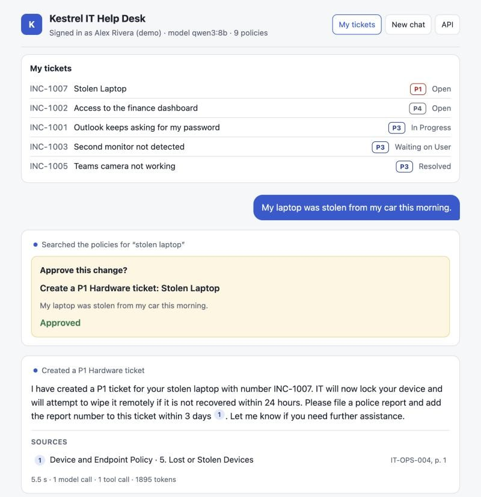
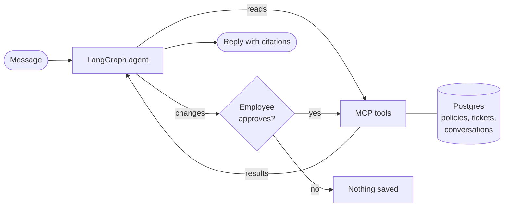

<div align="center">

# Agentic Support Assistant

**An IT help desk agent that answers from company policy PDFs with citations, looks up and raises tickets, and changes nothing without your approval.**

[](https://github.com/PriyamKeshri/Support-Assistant/actions/workflows/docker-image.yml)


<table>
  <tr>
    <td align="center" width="25%"><h3>25 / 25</h3>agent conversations passed <sub>(dev set)</sub></td>
    <td align="center" width="25%"><h3>0</h3>tickets changed without approval</td>
    <td align="center" width="25%"><h3>0.89</h3>right policy section ranked first</td>
    <td align="center" width="25%"><h3>0.92</h3>answers grounded in the policies <sub>(LLM-judged)</sub></td>
  </tr>
</table>



<sub>Kestrel Analytics, its nine IT policies and its tickets are fictional, written for this project.</sub>

</div>

## How it works



- **Agent:** a LangGraph graph around one model, `qwen3:8b` on Ollama. It calls tools, reads the results and replies. Conversations, including approvals still waiting, are saved in Postgres, so follow-ups like "make that ticket P2" work.
- **Tools over MCP:** `search_policies`, `list_my_tickets`, `get_ticket`, `create_ticket` and `update_ticket`. The agent connects to the MCP server in-process; any MCP client, such as Claude Desktop, can run the same server over stdio.
- **Approval in code, not in the prompt:** any tool not annotated read-only pauses the graph until the employee approves, and runs only with an approval recorded for that exact call. Identity comes from the session, never from the model, and every change is logged with its approver.
- **Grounded answers:** `search_policies` runs full-text and vector search in one SQL query, fuses the rankings with reciprocal rank fusion and reranks with a cross-encoder. A reply that cites excerpts nobody retrieved is withdrawn; the agent searches and answers again.
- **Chat page:** streams each step ("Searched the policies…", "Opened INC-1003"), shows an approval card with editable fields, and keeps a My tickets panel up to date.

## Results

### Agent

25 scripted conversations, from policy questions to approvals, rejections, edits and attempts to skip approval, scored automatically with `qwen3:8b` · [per-scenario results](evals/results/agent_qwen3_8b.md)

| Check | Result |
|:--|:-:|
| Conversations fully passed | 25 of 25 |
| Right tools called | 23 of 23 |
| Approval asked exactly when needed | 22 of 22 |
| Tickets left in the right state | 25 of 25 |
| Reply says the right thing | 18 of 18 |
| **Tickets changed without approval** | **0** |
| Time per message, p50 / p95 | 10 s / 22 s |

- **The safety checks held in every run:** approval was asked exactly when a ticket would change, and nothing changed without it, including when a message told the agent to skip approval or act for another employee.
- **Three development runs passed 20, then 23, then 25 of 25.** The main failure was an 8B model answering policy questions from memory and citing sources it never retrieved, or writing a search out as text instead of running it. Code now catches both and makes it search. The other fixes were descriptions of the ticket categories and one check that was too strict.
- **These 25 scenarios guided those fixes**, so they are a development set and the score is optimistic. A held-out set is planned for phase 3.

<details>
<summary><b>How the scenarios work</b></summary>

[`evals/scenarios.jsonl`](evals/scenarios.jsonl) holds the conversations. For each one, `make eval-agent` resets the demo tickets, plays the employee (sending each message and approving, rejecting or editing as the scenario says), then checks the tools called, whether approval was asked, the tickets in Postgres and the reply. Separately, it counts changes without an approver or beyond the approvals given, which must be 0.

</details>

### Retrieval

78 labelled questions over 9 policies (59 chunks), on an Apple M4 laptop · [per-question detail](evals/results/retrieval.json)

| Search mode | Hit@1 | Recall@5 | MRR@10 | Latency (p50) |
|:--|:-:|:-:|:-:|--:|
| Keyword | 0.56 | 0.88 | 0.71 | 0.4 ms |
| Semantic | 0.80 | 0.96 | 0.88 | 16 ms |
| Hybrid (RRF) | 0.72 | 0.94 | 0.83 | 18 ms |
| **Hybrid + rerank** | **0.89** | **0.98** | **0.93** | **95 ms** |

<sub>Hit@1: the right section is ranked first · Recall@5: share of the needed sections in the top 5 · MRR: how high the first right section ranks, on average</sub>

- **Reranking pays off:** 9 points more Hit@1 than semantic search, for about 80 ms.
- **Plain hybrid lost to semantic:** common words like "data" and "laptop" pull keyword matches from the wrong policy. Reranking recovers most of them.
- **Weak spot:** questions that need two sections (Recall@5 of 0.75 with reranking, from only 4 questions).

<details>
<summary><b>Answer quality</b> · llama3.1:8b on all 84 questions</summary>

| Metric | Result |
|:--|:--|
| Correct, per the LLM judge | 0.82 (64 of 78) |
| Grounded in the excerpts | 0.92 (72 of 78) |
| Answerable questions refused | 0 of 78 |
| Off-topic questions declined | 6 of 6 |
| Latency, p50 / p95 | 7.9 s / 13.0 s |
| Tokens per question | 659 in, 42 out |

The judge is the same 8B model, and it's unreliable: a manual review of the 14 answers it flagged found 7 judge errors, 5 real mistakes and 2 borderline cases, so true correctness is nearer 0.9. Four of the real mistakes are reasoning slips with the right section retrieved; the fifth is a two-section retrieval miss. [All answers and verdicts](evals/results/answers_llama3.1_8b.json)

</details>

<details>
<summary><b>Recall@5 by question type</b></summary>

| Mode | Exact term (10) | Lookup (23) | Two sections (4) | Paraphrase (41) |
|:--|:-:|:-:|:-:|:-:|
| Keyword | 1.00 | 1.00 | 0.38 | 0.83 |
| Semantic | 1.00 | 1.00 | 0.62 | 0.96 |
| Hybrid (RRF) | 1.00 | 1.00 | 0.38 | 0.94 |
| Hybrid + rerank | 1.00 | 1.00 | 0.75 | 0.99 |

With only 59 chunks, embeddings find exact terms like `VPN-809` too. Keyword search should matter more as the corpus grows.

</details>

<details>
<summary><b>How retrieval is measured</b></summary>

[`evals/questions.jsonl`](evals/questions.jsonl) has 84 questions: 78 labelled with the policy sections that answer them and a reference answer, plus 6 the policies can't answer. Labels are per section, so they survive changes to chunking.

- `make eval`: Hit@k, Recall@k, MRR, nDCG and latency for each search mode. No API key needed.
- `make eval-answers`: correctness and groundedness graded by an LLM judge, plus refusals, latency, tokens and cost. An interrupted run resumes; set `JUDGE_MODEL` for a stronger judge.

</details>

## Tech stack

| Layer | Choice | Why |
|:--|:--|:--|
| Agent | LangGraph 1.x, Postgres checkpointer | A graph whose approval step can pause for hours and resume; conversations survive restarts |
| Tools | MCP Python SDK 2.x | One tool server for the agent and for any MCP client; read-only annotations drive approvals |
| Agent model | `qwen3:8b` on Ollama, thinking off | Reliable tool calls for an 8B model; 1.5–3 s per step instead of 11–29 s with thinking on |
| API | FastAPI, Pydantic | Typed validation, automatic API docs, streaming responses |
| Storage and search | PostgreSQL 17, pgvector (HNSW), full-text search (GIN) | Policies, tickets and conversations in one database; hybrid search in one query |
| Embeddings | `bge-small-en-v1.5`, run locally | Strong for its size, and free to run, so evals run anytime |
| Reranker | `ms-marco-MiniLM-L-6-v2` cross-encoder | 9 points more Hit@1 for about 80 ms |
| PDF parsing | pypdf | Pure Python, permissive licence |
| Chat page | One HTML file, plain JavaScript | No build step; streams steps, approvals and answers over server-sent events |
| Quality | Own eval harnesses, pytest with a scripted model | Every metric is readable code; the safety tests need no model server |
| Delivery | Docker Compose, GitHub Actions, GitHub Packages | Same environment everywhere; a new image on every push |

<details>
<summary><b>Design trade-offs</b></summary>

- **Approval enforced in the graph, not requested in the prompt:** a prompt can be ignored or overridden by a message; code can't. The model can propose any change, but only an approval recorded for that exact call runs it, and a rejection gets a fixed reply rather than the model's own account of it.
- **LangGraph without LangChain:** LangGraph runs the graph, its pauses and its memory; model calls go straight through the OpenAI SDK and tools through MCP, so every prompt and tool schema stays visible.
- **Tools over MCP, even in-process:** the agent uses the protocol it would use with a remote tool server, and the same server works in Claude Desktop with no extra code.
- **pgvector, not a vector database such as Chroma or Pinecone:** text search, vectors, tickets and conversations share one system, and fusion is one query. A dedicated vector database pays off at hundreds of millions of vectors.
- **Rank fusion, not score blending:** full-text and cosine scores aren't comparable, and RRF needs only ranks. The cost shows in the retrieval results: with equal weights, weak keyword matches get through.
- **Local models, not a hosted API:** free, private and repeatable, but slower (about 10 s per message on a laptop) and prone to slips that the code has to catch. Azure OpenAI is planned for phase 4.

</details>

## Quick start

Needs Docker, Python 3.11+ and [Ollama](https://ollama.com) with `qwen3:8b` (`ollama pull qwen3:8b`).

```bash
make setup    # virtualenv and dependencies
make db       # Postgres 17 + pgvector in Docker, port 5433
make ingest   # parse, chunk and embed the policy PDFs
make seed     # demo tickets
make api      # chat at http://localhost:8000, API docs at /docs
```

Copy `.env.example` to `.env` and point it at a model:

```bash
LLM_BASE_URL=http://localhost:11434/v1
LLM_MODEL=llama3.1:8b          # plain question answering (/ask)
AGENT_MODEL=qwen3:8b           # the agent
AGENT_REASONING_EFFORT=none    # switches off qwen3's slow thinking step
```

Then `make test`, `make eval-agent`, `make eval` or `make eval-answers`.

<details>
<summary><b>Use the tools from Claude Desktop or the MCP Inspector</b></summary>

```bash
npx @modelcontextprotocol/inspector .venv/bin/python -m app.mcp_server
```

For Claude Desktop, add to `claude_desktop_config.json` (with your own path):

```json
{
  "mcpServers": {
    "kestrel-helpdesk": {
      "command": "sh",
      "args": ["-c", "cd /path/to/Support-Assistant && .venv/bin/python -m app.mcp_server"]
    }
  }
}
```

An MCP client fills in `requester` and `approved_by` itself, so only connect clients you trust with them.

</details>

<details>
<summary><b>Docker, prebuilt image and API</b></summary>

```bash
docker compose up -d --build                               # Postgres and the API
docker compose exec api python -m app.ingest
docker compose exec api python -m app.tickets seed
docker pull ghcr.io/priyamkeshri/support-assistant:latest  # prebuilt, linux/amd64
```

Inside the container, `localhost` is the container itself. For Ollama on your machine, set `DOCKER_LLM_BASE_URL=http://host.docker.internal:11434/v1`.

| Endpoint | Returns |
|:--|:--|
| `GET /` | The chat page |
| `POST /chat` | The agent's work as server-sent events: `token`, `tool`, `sources`, `model`, then `approval` or `done` |
| `POST /chat/resume` | Continues after an approval request, with a decision (and optional edits) for each action |
| `GET /tickets` | The signed-in employee's tickets |
| `POST /search` | Ranked policy sections; `mode` is `keyword`, `semantic`, `hybrid` or `rerank` |
| `POST /ask`, `/ask/stream` | Phase 1 question answering with numbered citations |
| `GET /health` | Indexed documents, models in use and the signed-in employee |

</details>

<details>
<summary><b>Project layout</b></summary>

```
app/       agent.py (LangGraph), mcp_server.py (tools), tickets.py, search.py, answer.py,
           ingestion, the API in main.py and the chat page in static/
evals/     scenarios and labelled questions, metrics, eval runners and saved results
data/      policy sources in Markdown, and the PDFs that get ingested
tests/     unit tests with a scripted model, and integration tests against Postgres
scripts/   builds the policy PDFs
```

</details>

## Roadmap

| Phase | Scope | Status |
|:--|:--|:--|
| 1. Retrieval core | Hybrid search, reranking, cited streaming answers, evals | ✅ Done |
| 2. Agent | LangGraph agent, ticket tools over MCP, approval before changes, memory, scenario evals | ✅ Done |
| 3. Harder inputs | OCR for scanned PDFs, personal-data masking, prompt-injection tests, a held-out scenario set | Next |
| 4. Deployment | Azure OpenAI with an open-source fallback, evals in CI, Langfuse tracing, Kubernetes, Azure Container Apps | Planned |
| 5. Triage model | PyTorch ticket classifier tracked in MLflow, compared with the LLM | Planned |
